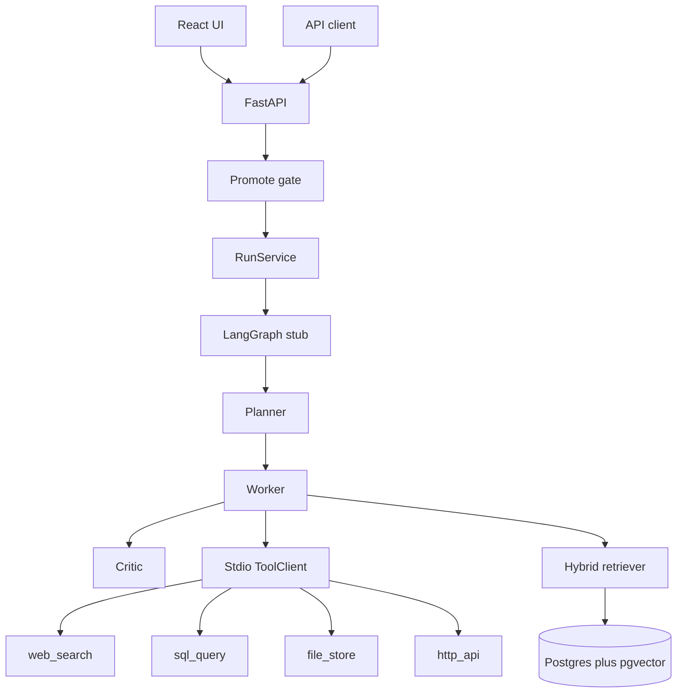

# Forge — Agentic Workflow Platform

Multi-agent platform: a LangGraph planner, worker, and critic over four MCP tool servers, with hybrid retrieval in Postgres and pgvector, behind FastAPI.

Live demo: [forge-desk.onrender.com](https://forge-desk.onrender.com). This is the Render free tier. It sleeps after about 15 minutes idle, and the first open after that takes about a minute. The public copy uses the keyword planner. Postgres and the records live inside that container, so a restart reloads them. There is no paid host. Locally, `http://127.0.0.1:8080` after `docker compose up --build`. `make tunnel` publishes that port only while this Mac is awake.  
Stack: LangGraph · MCP · pgvector · FastAPI · React · Docker.

Devansh Thakkar · thakkar.devan@northeastern.edu · [github.com/DevanshThakkar19](https://github.com/DevanshThakkar19)

## Architecture



Module rules: [docs/ARCHITECTURE.md](docs/ARCHITECTURE.md). Metric formulas: [docs/EVAL_PROTOCOL.md](docs/EVAL_PROTOCOL.md).

## What runs today

- `GET /health`
- `POST /v1/runs` and `GET /v1/runs/{id}` with header `X-API-Key`
- `GET /v1/metrics` returns the committed golden-set baseline
- LangGraph path: planner → worker → critic
- Four stdio MCP servers: `web_search`, `sql_query`, `file_store`, `http_api`
- The API spawns those servers and calls them over stdio. Tests and the golden-set runner use an in-process client on the same tool functions.
- Hybrid retrieval over `backend/corpus`: a local MiniLM embedding (384 dimensions) into pgvector, Postgres full text, reciprocal rank fusion, citations on the answer
- Promote gate on `mode=promote` and `mode=prod`

Search and the file sandbox are fixtures. They do not hit the network. `sql_query` runs one read-only SELECT against the Postgres `orders`, `docs`, and `cases` tables, and the HTTP routes read those same rows. Nothing on this path calls a paid API. The critic accepts a run only when every planned call succeeds, at least one citation comes back, and every query term of 5 or more characters appears in that evidence. A rejection gets one more pass over the same plan, then stays refused when the record is still missing. A file the agent just wrote does not count as evidence. Critic `confidence` is still a self-score, not the golden-set faithfulness number.

## Metrics

Golden set N=40, runtime `inprocess+memory`. Formulas and the gate are in [docs/EVAL_PROTOCOL.md](docs/EVAL_PROTOCOL.md). These clocks are the in-process runner, not a production p95. External cost is an estimate of $0 because there is no paid model.

| Metric | v0 | v1 | v2 | current (v3) |
| --- | --- | --- | --- | --- |
| p95 latency | 0.801 ms | 0.892 ms | 15.744 ms | 25.057 ms |
| Faithfulness | 0.8136 | 1.0 | 1.0 | 1.0 |
| Tool success | 1.0 | 1.0 | 1.0 | 1.0 |
| Decision accuracy | 0.875 | 1.0 | 1.0 | 1.0 |
| USD / successful task | 0 | 0 | 0 | 0 |

v0 fails the promote gate. v1, v2, and v3 pass. v1 is the hashing embedder, measured 2026-10-21, and that clock is under 1 ms. v2 is the local MiniLM embedder plus the live SQL tool. v3 adds Postgres-backed HTTP routes and one critic retry. p95 got slower again, because a refusal runs the plan a second time. Recompute with `make eval`.

One request to the public desk on 2026-10-23, `Where is order 1001?`, took 1289 ms inside the service and about 1.6 seconds including the network. That is one request, not a percentile.

## Quickstart

Python 3.11+.

```bash
python3 -m venv .venv
source .venv/bin/activate
pip install -e "./backend[dev]"
cp .env.example .env

make test
make run
```

API: `http://127.0.0.1:8000` · OpenAPI: `http://127.0.0.1:8000/docs`

```bash
curl -s http://127.0.0.1:8000/health

curl -s -X POST http://127.0.0.1:8000/v1/runs \
  -H "Content-Type: application/json" \
  -H "X-API-Key: dev-api-key" \
  -d '{"query":"Save a note about order 1001 from the http api and sql table"}'
```

Docker Compose starts Postgres with pgvector, the API, and the React UI. The UI is at `http://127.0.0.1:8080` and proxies `/health` and `/v1` to the API. The database password in the compose file is a local default. The sample company on the desk is Northline. Try `Where is order 1001?`, `What is case 4401?`, and `Which company is on the desk?` Compose sets `FORGE_PLANNER=local`, which asks a local Ollama model (`mistral`) to read a casually worded question and choose which lookups to open. The model does not write the answer. If Ollama is down, the keyword list is used and the check trail says so. The golden-set review always uses the keyword list, so the published numbers stay fixed. No paid model API is called.

```bash
docker compose up --build
```

For UI work without rebuilding the image, keep the API on port 8000 and run:

```bash
make ui
```

That serves the same screens at `http://127.0.0.1:5173` and proxies the API. The dev API key in the header field is `dev-api-key`.

```bash
make tunnel
```

MCP servers are stdio processes, not Compose services. From `backend/` after install:

```bash
python -m mcp_servers.web_search
python -m mcp_servers.sql_query
python -m mcp_servers.file_store
python -m mcp_servers.http_api
```

Each process waits on stdin. The API spawns them itself during startup. A manual `python -m` run is only for inspecting one server.

## API

| Method | Path | Auth |
| --- | --- | --- |
| GET | `/health` | no |
| POST | `/v1/runs` | `X-API-Key` |
| GET | `/v1/runs/{id}` | `X-API-Key` |
| GET | `/v1/metrics` | `X-API-Key` |

`POST /v1/runs` body: `{ "query": "...", "mode": "stub" }`. `mode` is `stub`, `promote`, or `prod`. `promote` and `prod` return 409 when the golden-set baseline misses the gate. The call finishes the graph before it responds. `accepted: false` means the critic rejected the run. `status: "failed"` means the graph raised. `GET /health` is `degraded` when Postgres is down. Each completed run includes `elapsed_ms`, `tool_count`, `tool_failures`, and `estimated_cost_usd` (0 on this stack).

## Layout

```
backend/app/api        HTTP routes
backend/app/graph      LangGraph planner, worker, critic
backend/app/mcp        tool catalog and ToolClient
backend/app/schemas    Pydantic contracts
backend/app/services   run lifecycle and in-memory store
backend/app/rag        chunk, hash embed, hybrid rank, pgvector index
backend/corpus         markdown the retriever indexes
backend/app/evals      golden-set scoring and the promote gate
backend/app/obs        per-run cost label (external spend is 0)
backend/mcp_servers    four stdio MCP servers
backend/evals          golden_set.jsonl and baselines/v0.json, v1.json, v2.json, v3.json, current.json
docs                   architecture and eval protocol
frontend               React run panel and metrics page
```

## Environment

See `.env.example`. `FORGE_API_KEY` defaults to `dev-api-key` for local runs. Change it before any shared deploy. `make run` expects Postgres from Compose so retrieval can index `backend/corpus`.

## Week plan

- [x] Repo scaffold, Compose, FastAPI health, run and status
- [x] LangGraph planner → worker → critic happy path
- [x] Four MCP servers, spawned over stdio by the API
- [x] Hybrid RAG ingest and cited retrieval
- [x] Golden set, eval protocol formulas, and the promote gate
- [x] React UI for a run and the golden-set metrics
- [x] GitHub Actions on [the public repo](https://github.com/DevanshThakkar19/forge-agent-platform)
- [x] Free public tunnel while this machine is running (`make tunnel`)

## Status of the definition of done

Compose, the four tools, cited retrieval, the promote gate, the golden-set table, and GitHub Actions are in place. `sql_query` reads the Postgres orders and cases tables. Retrieval uses a local MiniLM model. The published v3 clock is the in-process runner, p95 25.057 ms, slower than v2, and it is not a production p95. A stranger can open [forge-desk.onrender.com](https://forge-desk.onrender.com). That service sleeps after idle, uses the keyword planner, and runs the tool functions in-process. Four extra Python processes do not fit beside MiniLM and Postgres in 512 MB. Compose on this machine still uses stdio. The critic refuses an unsupported answer after one more pass. Search and files stay fixtures.
