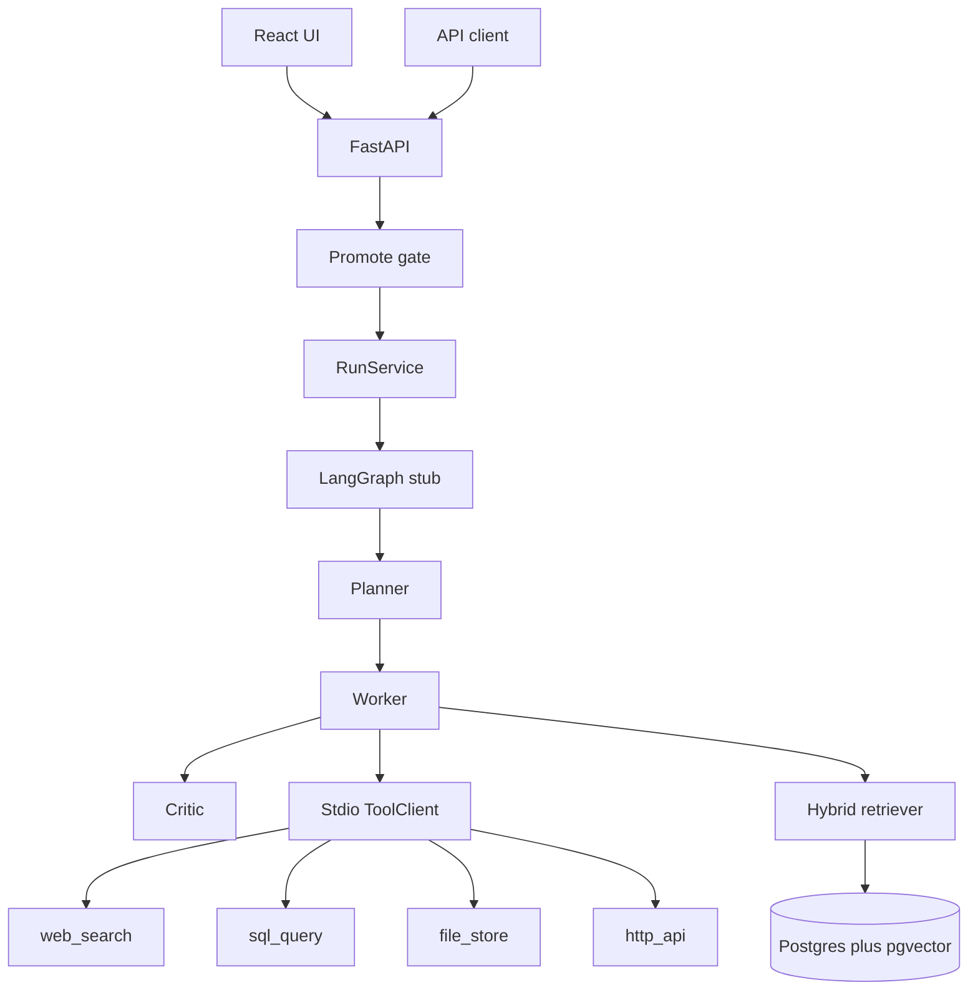

# Architecture

Forge is a single repo. The backend stays one Python package. The React app lives in `frontend/`.

## Request path

`POST /v1/runs` executes the graph in the request and stores the record in memory. A critic rejection is `status=completed` and `accepted=false`. `status=failed` means the graph raised.

## Module boundaries

| Module | Owns | Must not |
| --- | --- | --- |
| `mcp_servers/*` | Tool behavior and the stdio MCP server process | Import `app` |
| `app/mcp` | Catalog and `ToolClient` | Embed tool logic |
| `app/graph` | Planner, worker, critic, graph wiring | Import FastAPI or open sockets |
| `app/services` | Run lifecycle and the store | Know HTTP status codes |
| `app/api` | Routes, auth, status codes | Call tools directly |
| `app/schemas` | Pydantic contracts | Call tools or the graph |
| `app/rag` | Chunking, local MiniLM embedder, hybrid rank, pgvector index | Import FastAPI or MCP servers |
| `app/evals` | Golden-set loader, scorer, runner, promote gate | Invent a score that the runner did not write |
| `app/obs` | Cost label for a run | Treat one `elapsed_ms` as a p95, or invent a model bill |

The worker depends on `ToolClient` and `Retriever`, not on a server class or SQL. The API's client is `StdioToolClient`: one stdio session per MCP server. `InProcessToolClient` remains for fast tests and calls the same `TOOLS` functions the servers register.

Retrieval embeds the query with a local MiniLM model (384 dimensions, L2-normalized), takes cosine neighbors from pgvector and keyword hits from Postgres full text, and merges them with reciprocal rank fusion. `HashingEmbedder` remains in the repo as the older method. `sql_query` runs a read-only SELECT on the Postgres orders, docs, and cases tables. Search, files, and HTTP stay fixtures. If Postgres is down, health is `degraded` and retrieval returns `ok: false`.

## Add an MCP server

1. Add `backend/mcp_servers/<name>/tools.py` with a `TOOLS` dict of plain functions.
2. Add `server.py` that registers `TOOLS` through `mcp_servers.common.bootstrap.build_server`.
3. Register the dict in `app/mcp/registry.py`.
4. Teach `app/graph/nodes/planner.py` when to emit a `PlanStep` for it.
5. Extend `backend/tests/test_mcp_servers.py` so the server tool list cannot drift from the catalog.

## Failure modes in this slice

- Non-positive `timeout_s`, an unknown tool, a stdio timeout, or a tool exception become `ok: false`. The critic rejects the run.
- Empty retrieval and empty tool hits produce no citations. The critic rejects the run.
- A query term of 5 or more characters that is missing from non-file citations is rejected as unsupported. The sandbox file the agent just wrote is not evidence.
- `max_graph_steps` caps the plan, including the retrieval step.
- `sql_query` allows one `SELECT` and refuses writes, comments, and multiple statements.
- `file_store` resolves paths inside the sandbox and refuses `..` and absolute paths.
- Retries and an LLM planner are not in this slice.
